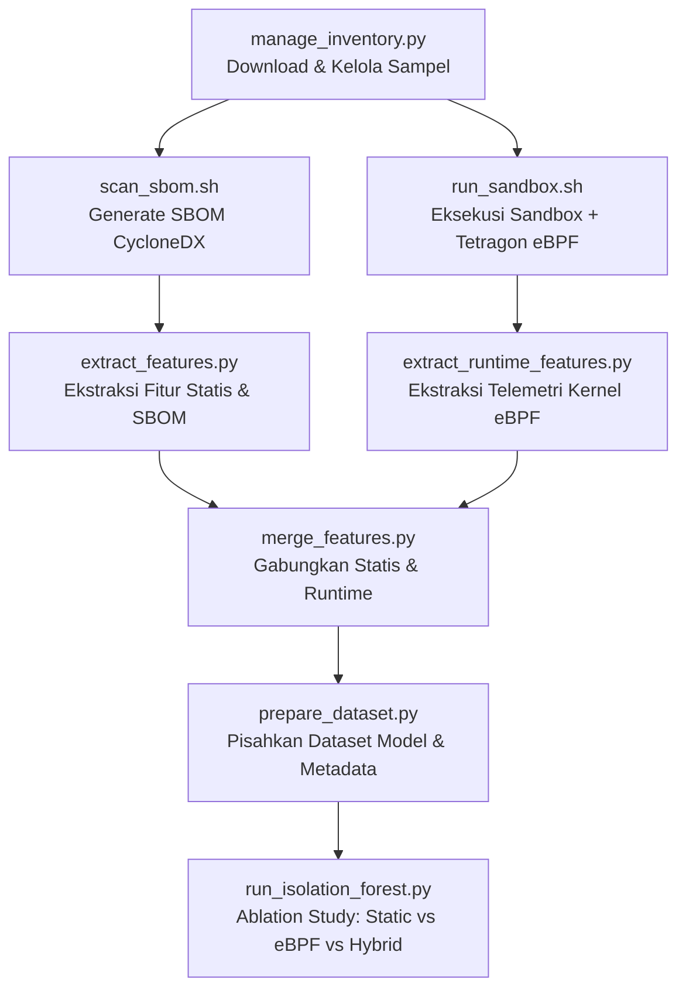

# Dokumentasi Pipeline & Script

Pipeline riset ini menguji deteksi malware paket perangkat lunak menggunakan kombinasi **Analisis Statis (SBOM & AST Pattern)**, **Analisis Dinamis/Runtime (eBPF Tetragon)**, dan **Machine Learning (Isolation Forest)** dengan dukungan komparasi *Ablation Study* (Static vs eBPF vs Hybrid).

---

## Alur Kerja Lengkap (End-to-End Workflow)

---

## Rincian Script

### 1. `manage_inventory.py`
* **Fungsi:** Mandor dataset & downloader sampel.
* **Penggunaan:**
  * Validasi CSV: `python scripts/manage_inventory.py --validate`
  * Lihat daftar paket: `python scripts/manage_inventory.py --list 10`
  * Download & ekstrak sampel: `python scripts/manage_inventory.py --get 1` (otomatis ekstrak ke `samples/source/1/`)

### 2. `scan_sbom.sh`
* **Fungsi:** Membuat daftar komponen perangkat lunak (SBOM format CycloneDX JSON) menggunakan Syft.
* **Penggunaan:**
  * Scan sampel tertentu: `bash scripts/scan_sbom.sh 1` (output: `results/sbom/1.json`)
  * Scan semua sampel: `bash scripts/scan_sbom.sh`

### 3. `extract_features.py`
* **Fungsi:** Mengekstrak fitur statis kode sumber (AST modules, suspicious regex patterns, lifecycle scripts) serta komponen SBOM.
* **Penggunaan:**
  * Otomatis membaca kode & auto-detect SBOM: `python scripts/extract_features.py samples/source/1`
  * Menyimpan / memperbarui baris data secara rapi ke `results/features.csv` tanpa duplikat ID.

### 4. `run_sandbox.sh` & `extract_runtime_features.py`
* **Fungsi:** 
  * `run_sandbox.sh`: Menjalankan sensor Cilium Tetragon eBPF di host, mock sinkhole server (port 80 & 8080), dan mengeksekusi paket npm di container Docker terisolasi.
  * `extract_runtime_features.py`: Mengekstrak telemetri runtime (jumlah proses, socket connection, spawned shells) dari log eBPF Tetragon ke `results/runtime_features.csv`.
* **Penggunaan:**
  * Jalankan sandbox per sampel: `bash scripts/run_sandbox.sh 1` (otomatis mengekstrak fitur runtime di akhir)
  * Ekstrak manual semua log eBPF: `python scripts/extract_runtime_features.py --all`

### 5. `merge_features.py`
* **Fungsi:** Menggabungkan fitur statis (`features.csv`) dan runtime (`runtime_features.csv`) berdasarkan ID sampel.
* **Penggunaan:** `python scripts/merge_features.py` (output: `results/combined_features.csv`)

### 6. `prepare_dataset.py`
* **Fungsi:** Data cleaning, imputasi missing values, dan memisahkan subset fitur untuk eksperimen *Ablation Study*:
  * `results/features_model_static.csv` (27 fitur statis + SBOM)
  * `results/features_model_runtime.csv` (4 fitur eBPF)
  * `results/features_model_combined.csv` (31 fitur gabungan)
  * `results/features_model_metadata.csv` (identitas ID, nama, versi)
* **Penggunaan:** `python scripts/prepare_dataset.py`

### 7. `run_isolation_forest.py`
* **Fungsi:** Melatih model Isolation Forest pada ketiga subset fitur (Static, eBPF, Hybrid) dan menghasilkan perbandingan *anomaly score* komparatif. Dilengkapi built-in engine murni Python jika `scikit-learn` belum terpasang.
* **Penggunaan:**
  * Komparasi 3 Model (Ablation Study): `python scripts/run_isolation_forest.py`
  * Output:
    * `results/isolation_forest_comparison.csv` (Tabel skor perbandingan lengkap)
    * `results/isolation_forest_results.csv` (Rapor default)
