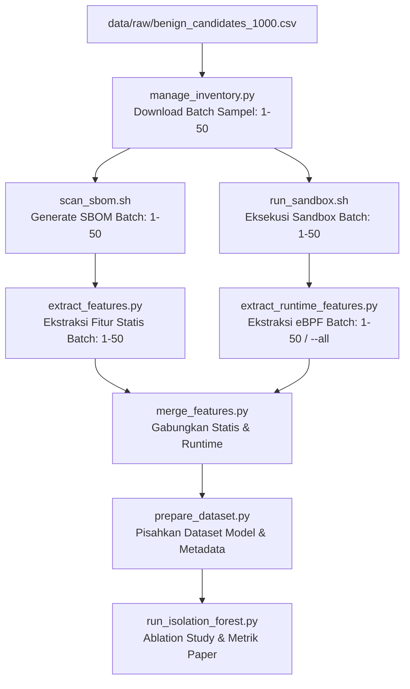

# Dokumentasi Pipeline & Script

Pipeline riset ini menguji deteksi malware paket perangkat lunak menggunakan kombinasi **Analisis Statis (SBOM & AST Pattern)**, **Analisis Dinamis/Runtime (eBPF Tetragon)**, dan **Machine Learning (Isolation Forest)** dengan dukungan komparasi *Ablation Study* (Static vs eBPF vs Hybrid) dan evaluasi metrik paper (ROC-AUC, Precision, Recall, F1-Score, FPR).

Seluruh script dirancang untuk mendukung **Batch Processing** (bisa memproses file sekaligus per rentang ID, misalnya `1-50` atau flag `--all`).

---

## Alur Kerja Lengkap (End-to-End Workflow)



---

## Rincian Script & Cara Penggunaan Batch (Contoh: ID 1-50)

### 1. `manage_inventory.py`
* **Fungsi:** Mandor dataset & downloader sampel (mendukung Malware Datadog via wget/unzip dan Benign npm via `npm pack`).
* **Cara Pakai Batch:**
  * **Download rentang sampel 1-50:**
    ```bash
    python scripts/manage_inventory.py --get-range 1-50
    ```
  * **Ingest kandidat benign baru:**
    ```bash
    python scripts/manage_inventory.py --ingest-benign 50
    ```
  * **Validasi inventory:**
    ```bash
    python scripts/manage_inventory.py --validate
    ```

### 2. `scan_sbom.sh`
* **Fungsi:** Membuat daftar komponen perangkat lunak (SBOM format CycloneDX JSON) per folder paket.
* **Cara Pakai Batch:**
  * **Scan rentang ID 1-50:**
    ```bash
    bash scripts/scan_sbom.sh 1-50
    ```
  * **Scan semua sampel yang ada di `samples/source/`:**
    ```bash
    bash scripts/scan_sbom.sh
    ```

### 3. `extract_features.py`
* **Fungsi:** Mengekstrak fitur statis kode sumber (AST modules, suspicious regex patterns, lifecycle scripts) serta komponen SBOM ke `results/features.csv`.
* **Cara Pakai Batch:**
  * **Ekstrak rentang ID 1-50:**
    ```bash
    python scripts/extract_features.py 1-50
    ```
  * **Ekstrak semua sampel yang ada:**
    ```bash
    python scripts/extract_features.py --all
    ```

### 4. `run_sandbox.sh`
* **Fungsi:** Menjalankan sensor Cilium Tetragon eBPF di host, mock sinkhole server (port 80 & 8080), dan mengeksekusi paket npm di container Docker terisolasi.
* **Cara Pakai Batch:**
  * **Jalankan sandbox rentang ID 1-50:**
    ```bash
    sudo ./scripts/run_sandbox.sh 1-50
    ```
  *(Catatan: Script ini otomatis memanggil `extract_runtime_features.py` per sampel setelah selesai dieksekusi).*

### 5. `extract_runtime_features.py`
* **Fungsi:** Mengekstrak telemetri runtime (jumlah proses, socket connection, spawned shells) dari log eBPF Tetragon ke `results/runtime_features.csv`.
* **Cara Pakai Batch:**
  * **Ekstrak log rentang ID 1-50:**
    ```bash
    python scripts/extract_runtime_features.py 1-50
    ```
  * **Ekstrak semua file log yang ada di `results/ebpf/*.json`:**
    ```bash
    python scripts/extract_runtime_features.py --all
    ```

### 6. `merge_features.py`
* **Fungsi:** Menggabungkan fitur statis (`features.csv`) dan runtime (`runtime_features.csv`) berdasarkan ID sampel secara otomatis.
* **Cara Pakai:**
  ```bash
  python scripts/merge_features.py
  ```

### 7. `prepare_dataset.py`
* **Fungsi:** Data cleaning, imputasi missing values, menautkan ground truth label (`benign`/`malicious`), dan memisahkan subset fitur model:
  * `results/features_model_static.csv`
  * `results/features_model_runtime.csv`
  * `results/features_model_combined.csv`
  * `results/features_model_metadata.csv`
* **Cara Pakai:**
  ```bash
  python scripts/prepare_dataset.py
  ```

### 8. `run_isolation_forest.py`
* **Fungsi:** Melatih model Isolation Forest pada ketiga subset fitur (Static, eBPF, Hybrid) dan menghasilkan perbandingan *anomaly score* komparatif serta **tabel metrik paper lengkap**.
* **Cara Pakai:**
  ```bash
  python scripts/run_isolation_forest.py
  ```
* **Output:**
  * `results/ablation_metrics_paper.csv` (ROC-AUC, Precision, Recall, F1-Score, FPR untuk Static vs eBPF vs Hybrid).
  * `results/isolation_forest_comparison.csv` (Perbandingan skor per sampel).
